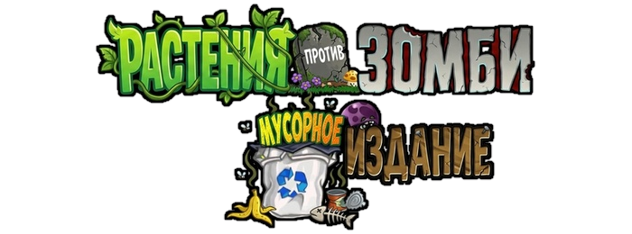

  

  # PvZ Waste RU

  **Русская локализация Plants vs. Zombies: Waste Edition**

  
  
  
  

  [О проекте](#что-это) · [Что переведено](#что-переведено) · [Скачать](#скачать) · [Установка](#установка) · [Обратная связь](#обратная-связь)

---

## Что это

**PvZ Waste RU** — фанатская русская локализация модификации **Plants vs. Zombies: Waste Edition (1.2 BugFix)**. Проект полностью переводит игру на русский язык, сохраняя её фирменный юмор, оригинальный стиль и настроение.

Русификатор распространяется бесплатно и не является официальным продуктом разработчиков модификации.

## Что переведено

- интерфейс, главное меню, настройки и встроенная консоль;
- все названия и описания растений и зомби в Альманахе;
- игровые режимы, мини-игры, головоломки и выживание;
- диалоги Безумного Дейва, магазин и Дерево Глупости;
- сюжетные записки зомби и памятка горячих клавиш;
- графика главного меню, логотип, кнопки, надгробия и экран поражения.

## Статус версии

**1.0 — актуальная версия русской локализации для PvZ Waste Edition 1.2 BugFix.**

Перевод полностью готов для комфортного прохождения всех режимов игры. Отдельные визуальные элементы и мелкие неточности могут дорабатываться в следующих обновлениях.

Если вы нашли проблему, отправьте [в Telegram-канал проекта](https://t.me/ModsForPvZ) скриншот и короткое описание — так её будет проще проверить и исправить.

## Скачать

[**Скачать PvZ Waste RU v1.0**](https://github.com/keiros06/PvZ-Waste-RU/releases/tag/v1.0)

Новости проекта и объявления о новых версиях публикуются в [Mods for PvZ](https://t.me/ModsForPvZ).

## Установка

1. Скачайте архив `PvZ-Waste-RU-v1.0.zip` со страницы релиза.
2. Распакуйте папку `PvZ Waste RU` в любое удобное место на диске.
3. Запустите `PvZ_Waste_RU.exe`.

## Обратная связь

Основной канал проекта — [**Mods for PvZ**](https://t.me/ModsForPvZ).

Туда можно отправлять:

- багрепорты и скриншоты;
- найденные опечатки или непереведённые места;
- предложения по улучшению;
- предложения помощи с графикой и тестированием;
- другие вопросы по проекту.

## Поддержать автора

Локализация бесплатная. Если вам нравится проект, при желании можно [добровольно поддержать дальнейшую работу](https://donatty.com/Keiros06).

## Команда проекта

**Keiros06** — автор текста и автор проекта

Отдельное спасибо всем, кто помогал с тестированием и поиском ошибок.

---

  **PvZ Waste RU by Keiros06**

